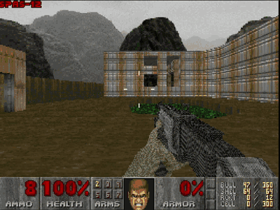
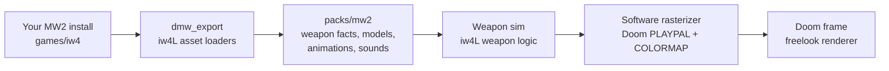

<p align="center">
  
</p>

<h1 align="center">IW4DOOM</h1>

<p align="center">
  <strong>Modern Warfare 2 (2009) gunplay in the classic Doom engine.</strong><br />
  Real MW2 weapon logic and real 3D viewmodels, drawn in Doom's own 256-colour palette. Unofficial. Bring your own game files.
</p>

<p align="center">
  
  
  
  
  
  
</p>

<p align="center">
  <a href="#quick-start">Quick start</a> ·
  <a href="#controls">Controls</a> ·
  <a href="#which-doom-version">Which Doom</a> ·
  <a href="#how-it-works">How it works</a> ·
  <a href="#faq">FAQ</a> ·
  <a href="#legal">Legal</a> ·
  <a href="#credits">Credits</a>
</p>


https://github.com/user-attachments/assets/b70fbc4a-1891-48b7-ae0e-106df93028c9

## What is this?

MW2's guns, in DOOM. The real ones.

IW4DOOM takes the weapons out of your copy of Modern Warfare 2 (models, animations, sounds) and hands them to the DOOM guy. Recoil, spread, reload times, aiming down sights: all of it runs on MW2's actual weapon code.

Then every gun gets crushed down to DOOM's 256 colours and DOOM's lighting, so everything blends together, without it feeling out of place.

Bring your own MW2 and DOOM. One script builds the rest.

## Features

<p align="center">
  
</p>

**3D viewmodels in Doom's palette.** Every triangle is shaded with Doom's light levels and quantized to the 256-colour palette. Shown here cycling through the MW2 arsenal.

- **MW2 weapon behaviour.** Fire rates, burst and semi-auto, magazine and shell-by-shell reloads, raise and drop times, recoil, spread bloom, sway and sprint all come from the weapon files.
- **Aim down sights and scopes.** The field of view zooms, sniper rifles get their scope overlay, and Shift holds your breath to steady the sway.
- **Ballistics.** MW2 damage with range falloff for bullets, explosive RPG rockets, and a hitmarker when you connect.
- **Freelook.** Look up and down with the mouse; the software renderer shears the view the way Doom ports traditionally do.
- **MW2 HUD touches.** Dynamic crosshair, ammo counter, weapon names, "Press F to open" and "Press R to reload" prompts.
- **MW2 sounds.** Fire, reload and handling sounds from your install, mixed beside Doom's own.
- **Saves.** Savegames keep your MW2 weapons and magazines; vanilla saves still load.
- **Configurable.** Remap any Doom weapon slot to any exported MW2 weapon, rebind keys, tune balance in `iw4doom.toml`.

## Quick start

You need your own copy of **MW2 (2009)** with multiplayer installed, and a **Doom WAD** ([which one?](#which-doom-version)). Runs on Linux and Windows 10/11.

1. Get the code:

   ```bash
   git clone https://github.com/Andrew2142/IW4DOOM.git
   cd IW4DOOM
   ```

2. Drop your MW2 folder and your Doom WAD into `games/`:

   ```text
   games/
     Call of Duty Modern Warfare 2/
     doom2.wad
   ```

3. Run it.

   Linux:

   ```bash
   ./iw4doom.sh
   ```

   Windows (or double-click it):

   ```bat
   iw4doom.bat
   ```

The first run builds everything (15–20 minutes) and asks before installing anything that's missing. After that it starts in seconds.

Need more detail? See the [full install guide](docs/INSTALL.md).

## Controls

| Action | Default |
| --- | --- |
| Move | W A S D |
| Look | Mouse |
| Fire | Left mouse button, Ctrl |
| Aim down sights | Right mouse button |
| Use (doors, switches) | F |
| Reload | R |
| Sprint / hold breath while aiming | Shift |
| Melee | V, mouse 4 |
| Last weapon | Q |
| Weapons | 1-7, mouse wheel |
| Turn | Left / right arrow |

Rebind them in `iw4doom.toml` (copy `iw4doom.example.toml`, which lists every setting at its default). The game reads `./iw4doom.toml`, then `~/.config/iw4doom/iw4doom.toml` on Linux or `%APPDATA%\iw4doom\iw4doom.toml` on Windows.

## Which Doom version

Any Doom IWAD works. IW4DOOM uses the classic WAD files, not a newer engine.

- **DOOM and DOOM II on Steam.** The Steam versions include the classic `DOOM.WAD` and `DOOM2.WAD`; find them in the game's install folder (on Windows under `C:\Program Files (x86)\Steam\steamapps\common\`, for example `Ultimate Doom`) and copy or link them into `games/doom/`. Final Doom's `PLUTONIA.WAD` and `TNT.WAD` work too.
- **Shareware Doom (free).** Episode 1 only. On Debian or Ubuntu: `sudo apt install doom-wad-shareware`, then `ln -s /usr/share/games/doom/doom1.wad games/doom/`.
- **Freedoom (free and open).** A complete replacement IWAD: download `freedoom1.wad` / `freedoom2.wad` from [freedoom.github.io](https://freedoom.github.io) into `games/doom/`.

With several IWADs, IW4DOOM prefers `doom2.wad`, then `doom.wad`, `plutonia.wad`, `tnt.wad`, `freedoom2.wad`, `freedoom1.wad`, `doom1.wad`.

## Weapons

| Key | Doom weapon | MW2 weapon |
| :---: | --- | --- |
| 1 | Fist, chainsaw | (Doom's own) |
| 2 | Pistol | USP .45 |
| 3 | Shotgun | SPAS-12 |
| 3 | Super shotgun | Ranger |
| 4 | Chaingun | M4A1 |
| 5 | Rocket launcher | RPG-7 |
| 6 | Plasma rifle | MG4 |
| 7 | BFG 9000 | Barrett .50cal |

Shareware `doom1.wad` has no super shotgun, plasma rifle or BFG, so you get the USP, SPAS-12, M4A1 and RPG-7. The pack also contains the Intervention, AA-12, Vector and Desert Eagle; map them onto any slot in the `[weapons]` section of `iw4doom.toml`. Ammo still comes from Doom's pickups.

## How it works



1. **Export, once, on your machine.** `dmw_export` uses iw4L's loaders to read your MW2 multiplayer files and writes a pack to `packs/mw2`: weapon numbers, viewmodel meshes and textures, animations and sounds. The pack never leaves your machine.
2. **Simulate.** Each Doom tic, the weapon simulation runs iw4L's port of MW2's weapon state machine with your inputs: firing, reloading, ADS, sprint, recoil, spread and sway. Shots become Doom hitscans or projectiles with MW2 damage.
3. **Animate.** The viewmodel animator plays the weapon's own animations and places the gun like MW2 does, including kick and sway.
4. **Rasterize.** A software rasterizer draws the 3D viewmodel into Doom's 320x200 frame, quantizes every texture to `PLAYPAL` and lights each pixel through `COLORMAP` with the sector's light level.
5. **Present.** Doom's renderer, extended with freelook and FOV zoom, draws the world; the HUD adds the crosshair, scope overlays and prompts.

The engine is [room](https://github.com/sunsided/room), a Rust port of doomgeneric. Engine changes are small hooks; the MW2 code lives beside it.

## What's next

- Weapon balance tuned properly against Doom's monsters
- New enemy types
- Weapon pickups on the floor using MW2's real 3D models instead of Doom sprites
- More guns from MW2's arsenal

## FAQ

<details>
<summary><strong>Are any game files included?</strong></summary>

No. The repository contains code only. You need your own MW2 (2009) install and your own Doom IWAD (or the free shareware or Freedoom IWADs). The weapon pack is made from your install, on your machine, and stays there.
</details>

<details>
<summary><strong>Is there multiplayer?</strong></summary>

No. It is single-player Doom with MW2 weapons. Nothing connects to any server.
</details>

<details>
<summary><strong>Does it run on Windows or macOS?</strong></summary>

Linux and Windows 10/11 (64-bit): `./iw4doom.sh` on Linux, `iw4doom.bat` on Windows. Windows support is new, so please open an issue when something breaks there. macOS is not supported.
</details>

<details>
<summary><strong>Why does it look so retro?</strong></summary>

On purpose. The guns are drawn at Doom's resolution with Doom's 256 colours and Doom's lighting, so they sit in the world instead of floating over it. The weapon behaviour underneath is the modern part.
</details>

<details>
<summary><strong>Setup failed. Where do I look?</strong></summary>

`iw4doom.sh` / `iw4doom.bat` print what failed and what to do about it; everything they ran is in `iw4doom.log`. If the export fails, `packs/mw2/report.json` (after a successful export) and `iw4doom.log` list what was skipped and why. Add `--reexport` to export again.
</details>

<details>
<summary><strong>Windows: something went wrong. What now?</strong></summary>

- **The window closed too fast to read.** Run `iw4doom.bat` from a Command Prompt instead of double-clicking, or read `iw4doom.log`. On failure the window waits for a key press.
- **"Running scripts is disabled on this system".** Start the game with `iw4doom.bat`, which bypasses the execution policy for that run only, or use `powershell -ExecutionPolicy Bypass -File iw4doom.ps1`.
- **`games\iw4` has no zone folder.** It is probably a symbolic link made without Developer Mode. Delete it and make a junction with `mklink /J` (see [Windows](#windows)).
- **`link.exe` not found, or the build fails right away.** The Visual Studio C++ build tools are missing or incomplete. Install Build Tools for Visual Studio with the "Desktop development with C++" workload, then open a new terminal.
- **Rust was just installed but is not found.** Open a new terminal (or log out and in) so the new PATH applies, then run `iw4doom.bat` again.
- **The antivirus removed `iw4doom.exe` or the exporter.** Freshly compiled programs are sometimes flagged. Restore the file and add an exclusion for the IW4DOOM folder, then run `iw4doom.bat` again.
- **The build fails with "path too long" errors.** Clone IW4DOOM to a short path such as `C:\Games\IW4DOOM`.
- **The mouse does not turn the view.** Click into the game window once; it captures the mouse while you play and releases it in the menu.
</details>

## Legal

IW4DOOM is an unofficial fan project. It is not affiliated with, endorsed by or sponsored by Activision, Infinity Ward, id Software, Bethesda or ZeniMax. Call of Duty and Modern Warfare are trademarks of Activision Publishing; DOOM is a trademark of id Software. All trademarks belong to their owners.

You must own the games you use with it. IW4DOOM contains no game data and downloads none: it reads the files you put in `games/` and writes the derived pack to `packs/`, both ignored by git and never uploaded. Do not share your pack.

The combined work is licensed **GPL-3.0-or-later** ([LICENSE](LICENSE)). The Doom engine code is GPL-2.0-or-later ([LICENSE-GPL-2.0](LICENSE-GPL-2.0)); code ported from iw4L is Apache-2.0 ([LICENSE-APACHE-2.0](LICENSE-APACHE-2.0)). See [NOTICE](NOTICE) and [docs/provenance.md](docs/provenance.md).

## Documentation

- [Build specs](docs/specs/README.md): the full design, starting with `00-overview-and-contracts.md`
- [AGENTS.md](AGENTS.md): rules for contributors and coding agents
- [Release checklist](docs/RELEASE.md)
- [Provenance](docs/provenance.md): what came from where

## Credits

IW4DOOM is built on these projects. If you enjoy it, go and support them.

- [**iw4L**](https://github.com/vladtrc/iw4L) by vladtrc: the MW2 weapon logic and asset readers behind the gunplay.
- [**room**](https://github.com/sunsided/room) by sunsided: the Rust Doom engine IW4DOOM forks.
- [**doomgeneric**](https://github.com/ozkl/doomgeneric) by ozkl: the portable Doom source room is ported from.

If you enjoyed this project, don't forget to star the repo.

IW4DOOM is alpha software. Expect rough edges, and please open an issue when something breaks.
