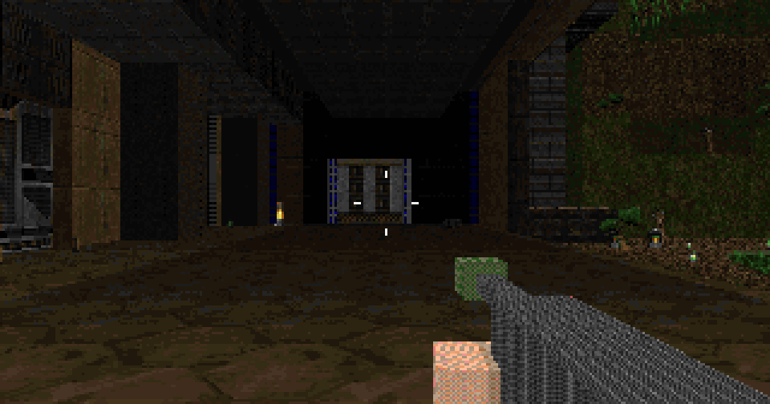
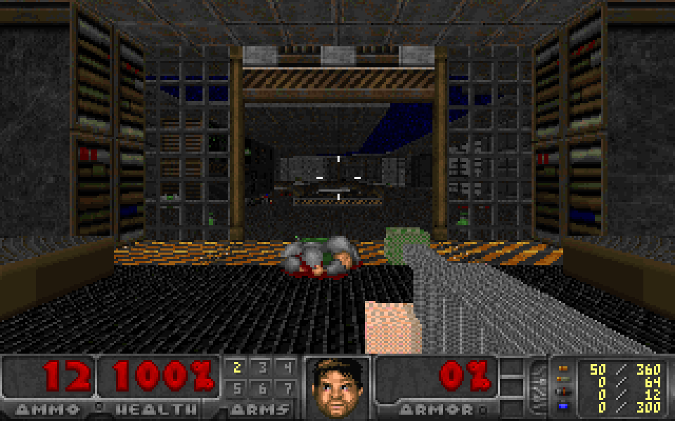
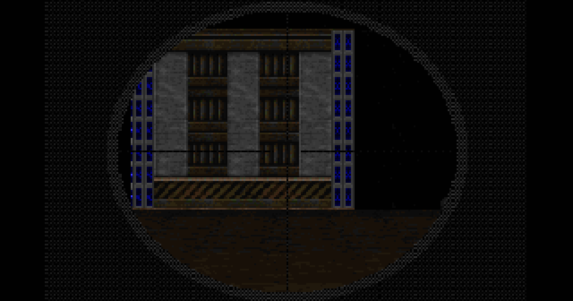
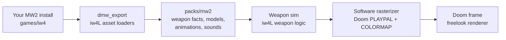

<p align="center">
  
</p>

<h1 align="center">IW4DOOM</h1>

<p align="center">
  <strong>Modern Warfare 2 (2009) gunplay in the classic Doom engine.</strong><br />
  Real MW2 weapon logic and real 3D viewmodels, drawn in Doom's own 256-colour palette. Unofficial. Bring your own game files.
</p>

<p align="center">
  
  
  
  
  
</p>

<p align="center">
  <a href="#quick-start">Quick start</a> ·
  <a href="#controls">Controls</a> ·
  <a href="#which-doom-version">Which Doom</a> ·
  <a href="#how-it-works">How it works</a> ·
  <a href="#faq">FAQ</a> ·
  <a href="#legal">Legal</a>
</p>

<!-- DEMO VIDEO: paste the GitHub user-attachments video URL here -->

<p align="center">
  
</p>
<p align="center"><sub>Freedoom with the built-in placeholder gun. With your own MW2 install you get the real weapons.</sub></p>

## Why

Doom's weapons are sprites that bob. MW2's are 3D models with a full state machine behind them: raise and drop times, magazine reloads, recoil that kicks the view, spread that blooms while you fire and tightens when you aim down sights, sway, sprinting, and damage that falls off with range.

IW4DOOM puts that second system inside the first, and makes it look like it belongs there.

- **The real rules, not an imitation.** The weapon logic is [iw4L](https://github.com/vladtrc/iw4L)'s Rust port of MW2's, fed with the numbers from your own MW2 install.
- **The real models, the old look.** Viewmodels are rendered in 3D by a software rasterizer, then pushed through Doom's palette and light tables, so a gun in a dark corridor is as dark as the corridor.
- **Doom stays Doom.** Maps, monsters, items and demos are untouched. Turn MW2 mode off (`-nomw2`) and it plays exactly like the engine it is built on.

## Features

<table>
  <tr>
    <td width="50%"></td>
    <td width="50%"></td>
  </tr>
  <tr>
    <td><strong>3D viewmodels in Doom's palette</strong><br />Every triangle is shaded with Doom's light levels and quantized to the 256-colour palette. Shown here with the built-in placeholder gun.</td>
    <td><strong>Aim down sights and scopes</strong><br />The field of view zooms, sniper rifles get their scope overlay, and Shift holds your breath to steady the sway.</td>
  </tr>
</table>

- **MW2 weapon behaviour.** Fire rates, burst and semi-auto, magazine and shell-by-shell reloads, raise and drop times, recoil, spread bloom, sway and sprint all come from the weapon files.
- **Ballistics.** MW2 damage with range falloff for bullets, explosive RPG rockets, and a hitmarker when you connect.
- **Freelook.** Look up and down with the mouse; the software renderer shears the view the way Doom ports traditionally do.
- **MW2 HUD touches.** Dynamic crosshair, ammo counter, weapon names, "Press F to open" and "Press R to reload" prompts.
- **MW2 sounds.** Fire, reload and handling sounds from your install, mixed beside Doom's own.
- **Saves.** Savegames keep your MW2 weapons and magazines; vanilla saves still load.
- **Configurable.** Remap any Doom weapon slot to any exported MW2 weapon, rebind keys, tune balance in `iw4doom.toml`.

## Quick start

You need Linux, about 4 GB of free disk space for the build, your own copy of **Call of Duty: Modern Warfare 2 (2009)** with its multiplayer component installed, and a **Doom IWAD** (see [Which Doom version](#which-doom-version)).

```bash
git clone https://github.com/Andrew2142/IW4DOOM.git
cd IW4DOOM
```

Put your game files in `games/` (symlinks are fine, so nothing large is copied):

```text
games/
  iw4/            your MW2 multiplayer install (the folder with iw4mp.exe, main/ and zone/)
  doom/           one or more Doom IWADs: doom2.wad, doom.wad, doom1.wad, freedoom1.wad, ...
  soundfont.sf2   optional: a General MIDI soundfont for music
```

```bash
ln -s "$HOME/.steam/steam/steamapps/common/Call of Duty Modern Warfare 2" games/iw4
mkdir -p games/doom && cp /path/to/DOOM2.WAD games/doom/
./setup.sh
./play.sh
```

`setup.sh` checks your files and your machine, builds the exporter, turns your MW2 install into a weapon pack in `packs/mw2`, builds the game, runs a short headless smoke test and writes `play.sh`. The first run takes 15-20 minutes, mostly compiling; later runs take seconds. If something is missing it tells you exactly what, including the one install command to run (it never uses `sudo` itself). Full output goes to `setup.log`.

`./play.sh --list` shows the IWADs it found, `./play.sh --iwad doom1.wad` picks one, and any other arguments go to the game (`./play.sh -warp 1 1 -skill 4`).

## Controls

| Action | Default |
| --- | --- |
| Move | W A S D |
| Look | Mouse |
| Fire | Left mouse button, Ctrl |
| Aim down sights | Right mouse button |
| Use (doors, switches) | F |
| Reload | R |
| Sprint / hold breath while aiming | Shift |
| Melee | V, mouse 4 |
| Last weapon | Q |
| Weapons | 1-7, mouse wheel |
| Turn | Left / right arrow |

Rebind them in `iw4doom.toml` (copy `iw4doom.example.toml`, which lists every setting at its default). The game reads `./iw4doom.toml`, then `~/.config/iw4doom/iw4doom.toml`.

## Which Doom version

Any Doom IWAD works. IW4DOOM uses the classic WAD files, not a newer engine.

- **DOOM and DOOM II on Steam.** The Steam versions include the classic `DOOM.WAD` and `DOOM2.WAD`; find them in the game's install folder and copy or symlink them into `games/doom/`. Final Doom's `PLUTONIA.WAD` and `TNT.WAD` work too.
- **Shareware Doom (free).** Episode 1 only. On Debian or Ubuntu: `sudo apt install doom-wad-shareware`, then `ln -s /usr/share/games/doom/doom1.wad games/doom/`.
- **Freedoom (free and open).** A complete replacement IWAD: download `freedoom1.wad` / `freedoom2.wad` from [freedoom.github.io](https://freedoom.github.io) into `games/doom/`.

With several IWADs, `play.sh` prefers `doom2.wad`, then `doom.wad`, `plutonia.wad`, `tnt.wad`, `freedoom2.wad`, `freedoom1.wad`, `doom1.wad`.

## Weapons

| Key | Doom weapon | MW2 weapon |
| :---: | --- | --- |
| 1 | Fist, chainsaw | (Doom's own) |
| 2 | Pistol | USP .45 |
| 3 | Shotgun | SPAS-12 |
| 3 | Super shotgun | Ranger |
| 4 | Chaingun | M4A1 |
| 5 | Rocket launcher | RPG-7 |
| 6 | Plasma rifle | MG4 |
| 7 | BFG 9000 | Barrett .50cal |

Shareware `doom1.wad` has no super shotgun, plasma rifle or BFG, so you get the USP, SPAS-12, M4A1 and RPG-7. The pack also contains the Intervention, AA-12, Vector and Desert Eagle; map them onto any slot in the `[weapons]` section of `iw4doom.toml`. Ammo still comes from Doom's pickups.

## How it works



1. **Export, once, on your machine.** `dmw_export` uses iw4L's loaders to read your MW2 multiplayer files and writes a pack to `packs/mw2`: weapon numbers, viewmodel meshes and textures, animations and sounds. The pack never leaves your machine.
2. **Simulate.** Each Doom tic, the weapon simulation runs iw4L's port of MW2's weapon state machine with your inputs: firing, reloading, ADS, sprint, recoil, spread and sway. Shots become Doom hitscans or projectiles with MW2 damage.
3. **Animate.** The viewmodel animator plays the weapon's own animations and places the gun like MW2 does, including kick and sway.
4. **Rasterize.** A software rasterizer draws the 3D viewmodel into Doom's 320x200 frame, quantizes every texture to `PLAYPAL` and lights each pixel through `COLORMAP` with the sector's light level.
5. **Present.** Doom's renderer, extended with freelook and FOV zoom, draws the world; the HUD adds the crosshair, scope overlays and prompts.

The engine is [room](https://github.com/sunsided/room), a Rust port of doomgeneric. Engine changes are small hooks; the MW2 code lives beside it.

## FAQ

<details>
<summary><strong>Are any game files included?</strong></summary>

No. The repository contains code only. You need your own MW2 (2009) install and your own Doom IWAD (or the free shareware or Freedoom IWADs). The weapon pack is made from your install, on your machine, and stays there.
</details>

<details>
<summary><strong>Is there multiplayer?</strong></summary>

No. It is single-player Doom with MW2 weapons. Nothing connects to any server.
</details>

<details>
<summary><strong>Does it run on Windows or macOS?</strong></summary>

Linux only for now. The engine itself is portable Rust, but `setup.sh` and the build have only been tested on Linux.
</details>

<details>
<summary><strong>Why does it look so retro?</strong></summary>

On purpose. The guns are drawn at Doom's resolution with Doom's 256 colours and Doom's lighting, so they sit in the world instead of floating over it. The weapon behaviour underneath is the modern part.
</details>

<details>
<summary><strong>Setup failed. Where do I look?</strong></summary>

`setup.sh` prints what failed and what to do about it; everything it ran is in `setup.log`. If the export fails, `packs/mw2/report.json` (after a successful export) and `setup.log` list what was skipped and why. Run `./setup.sh --reexport` to export again.
</details>

## Legal

IW4DOOM is an unofficial fan project. It is not affiliated with, endorsed by or sponsored by Activision, Infinity Ward, id Software, Bethesda or ZeniMax. Call of Duty and Modern Warfare are trademarks of Activision Publishing; DOOM is a trademark of id Software. All trademarks belong to their owners.

You must own the games you use with it. IW4DOOM contains no game data and downloads none: it reads the files you put in `games/` and writes the derived pack to `packs/`, both ignored by git and never uploaded. Do not share your pack.

The combined work is licensed **GPL-3.0-or-later** ([LICENSE](LICENSE)). The Doom engine code is GPL-2.0-or-later ([LICENSE-GPL-2.0](LICENSE-GPL-2.0)); code ported from iw4L is Apache-2.0 ([LICENSE-APACHE-2.0](LICENSE-APACHE-2.0)). See [NOTICE](NOTICE) and [docs/provenance.md](docs/provenance.md).

Credits: [room](https://github.com/sunsided/room) (Rust doomgeneric port), [iw4L](https://github.com/vladtrc/iw4L) (MW2 runtime in Rust), [Chocolate Doom](https://github.com/chocolate-doom/chocolate-doom) and [doomgeneric](https://github.com/ozkl/doomgeneric), and [Freedoom](https://freedoom.github.io) for the IWADs used in tests and screenshots.

## Documentation

- [Build specs](docs/specs/README.md): the full design, starting with `00-overview-and-contracts.md`
- [AGENTS.md](AGENTS.md): rules for contributors and coding agents
- [Release checklist](docs/RELEASE.md)
- [Provenance](docs/provenance.md): what came from where

### For developers

The internal crate names still use the project's working name, DOOMMW2 (`room`, `dmw_format`, `dmw_weapons`, `dmw_viewmodel`, `tools/dmw_export`).

| Command | What it does |
| --- | --- |
| `task check` | `cargo check` for the workspace |
| `task lint` | clippy on the new crates, the engine glue gate, crate boundaries |
| `task test` | all tests; `demo_playthrough` needs the shareware IWAD at `games/doom/doom1.wad` (or `DMW_DOOM1_WAD`) and is skipped with a notice otherwise |
| `task fetch-wads` | download the pinned Freedoom IWADs into `wads/` (tests use them) |
| `task run-fixture -- -warp 1 1` | play on Freedoom with the built-in placeholder gun, no MW2 needed |
| `task export` | export your MW2 install to `packs/mw2` (`DMW_MW2_GAMES=games`) |

iw4L is a git dependency pinned to `IW4L_REV`. To build against a local checkout, copy `.cargo/config.toml.example` to `.cargo/config.toml`. Tests never need MW2 data: they use Freedoom and the in-memory fixture pack (`-fixturepack`).

IW4DOOM is alpha software. Expect rough edges, and please open an issue when something breaks.
